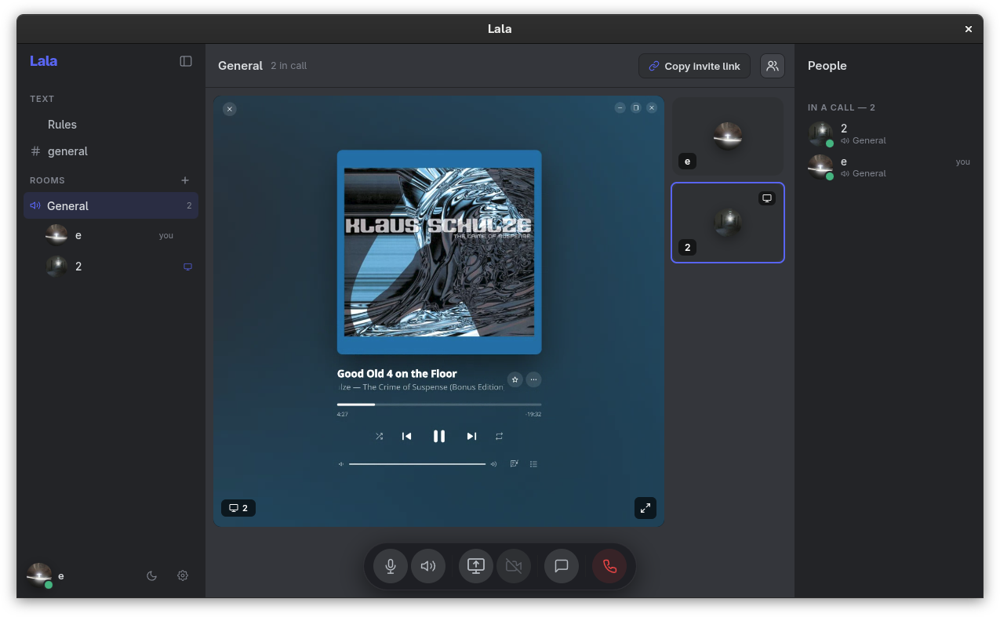

# Lala

Self-hosted voice and video chat for small groups, in the browser and as a desktop app for Windows
and Linux.

[](https://github.com/eeegoloauq/lala/releases/latest)
[](https://github.com/eeegoloauq/lala/actions/workflows/images.yml)
[](https://copr.fedorainfracloud.org/coprs/eeegoloauq/lala/)
[](LICENSE)



- End-to-end encryption for password-protected rooms
- Screen sharing with system audio in the desktop app
- RNNoise noise suppression
- No database, no accounts
- Five themes, including AMOLED and Windows XP

[Try the demo](https://eeegoloauq.github.io/lala/) in your browser with simulated people · [All features](docs/features.md)

## Download

Get the desktop app from the [latest release](https://github.com/eeegoloauq/lala/releases/latest).
On Fedora, install it from [Copr](https://copr.fedorainfracloud.org/coprs/eeegoloauq/lala/):

```bash
sudo dnf copr enable eeegoloauq/lala
sudo dnf install lala-desktop
```

## Self-hosting

Runs on [LiveKit](https://livekit.io/) and Redis with Docker Compose. You need a server with a
public IP and two domains.

```bash
git clone https://github.com/eeegoloauq/lala.git && cd lala
./setup.sh              # asks for your domains and makes the keys
docker compose up -d
```

[Step-by-step guide](docs/self-hosting.md): domains, reverse proxy, admins, private server, ports.

## Development

[Contributing and local setup](CONTRIBUTING.md) · [Translations](CONTRIBUTING.md#translations) · [Theming](docs/theming.md) · [Architecture and security](docs/architecture.md) · [Client API](docs/api.md) · [Roadmap](ROADMAP.md) · [Security policy](SECURITY.md)

## License

[MIT](LICENSE)
