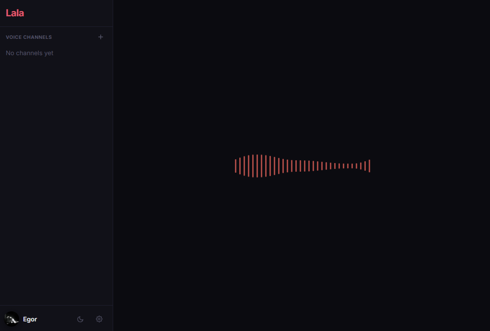
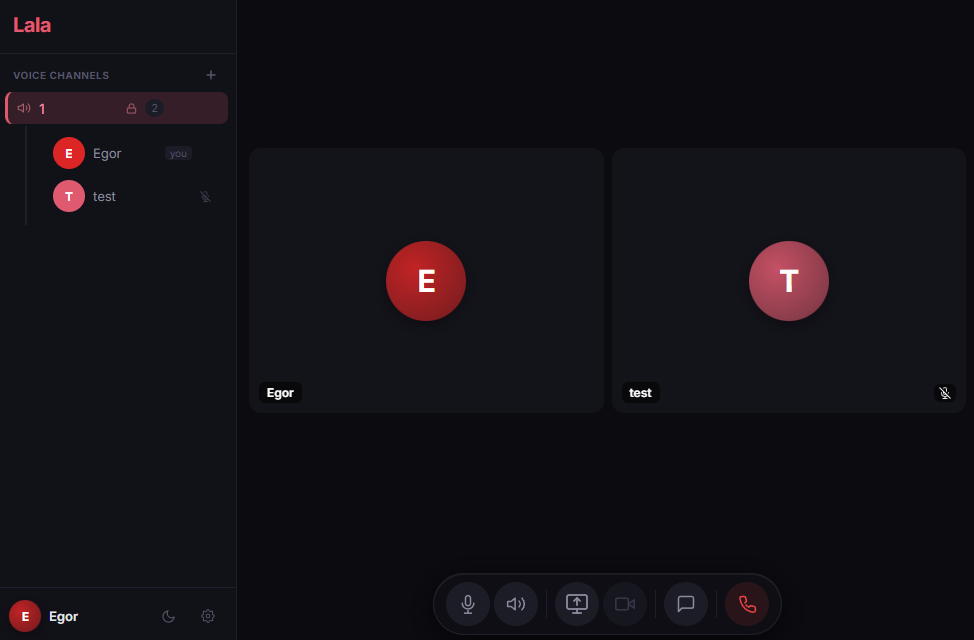

# Features

Self-hosted voice and video chat inspired by Mumble and Discord, built on
[LiveKit](https://livekit.io/). No database: rooms are ephemeral, chat goes over data channels, and
state lives in LiveKit and Redis.

- Voice and video with configurable audio quality (speech / music / high-quality stereo)
- End-to-end encryption for password-protected rooms in browsers that support it (AES-GCM)
- Screen sharing with quality/FPS controls; the desktop app also shares system audio
- Chat over data channels with emoji picker and TTS
- Room admin: kick, ban, mute; passwords hashed with scrypt
- 5 themes: dark, light, AMOLED, Discord, Windows XP
- RNNoise noise suppression (AudioWorklet)
- Desktop app with auto-updates, tray, native screen share picker

<p>
  
  
</p>

## Desktop app

Lala works in the browser. There is also a desktop client:

- **Windows**: installer from [Releases](https://github.com/eeegoloauq/lala/releases), auto-updates itself.
- **Fedora**: [Copr](https://copr.fedorainfracloud.org/coprs/eeegoloauq/lala/), updated with `dnf upgrade`:

  ```bash
  sudo dnf copr enable eeegoloauq/lala
  sudo dnf install lala-desktop
  ```

- **Other Linux**: AppImage / rpm / tar.gz from [Releases](https://github.com/eeegoloauq/lala/releases).
